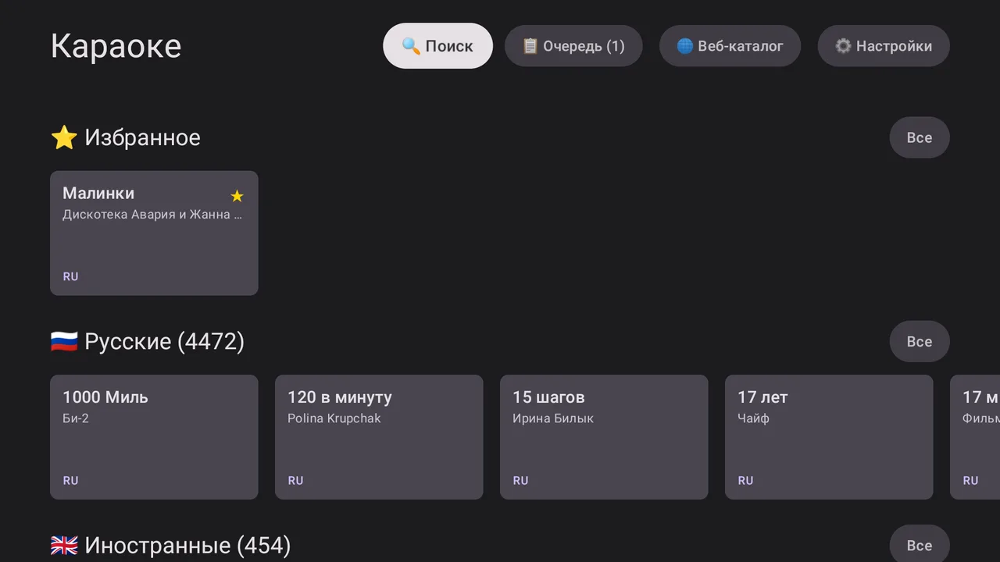

  

<h1 align="center">Караоке Плюс</h1>

  <strong>Ваши любимые песни — на большом экране.</strong> 
  Караоке-плеер для телевизоров и приставок с Android TV.

  Android TV 7.0+ &nbsp; · &nbsp; Управление с пульта &nbsp; · &nbsp; Песни с флешки

  

  <a href="https://karaoke-plus.ru/">Сайт приложения</a> &nbsp; · &nbsp;
  <a href="https://github.com/gornyyvladimir/karaoke-updates/releases">Версии и изменения</a> &nbsp; · &nbsp;
  <a href="https://karaoke-plus.ru/docs/user/installation">Как установить</a> &nbsp; · &nbsp;
  <a href="https://t.me/karaoke_plus_ru">Поддержка</a>

  

  На скриншоте — пример личной коллекции. Готовые песни в приложение не входят.

## Пойте дома, как вам нравится

Подключите флешку со своими караоке-видео, выберите папку с песнями и начинайте петь. Приложение соберёт коллекцию в удобную библиотеку для большого экрана.

- **Без ограничений на пение.** В бесплатной версии можно петь сколько угодно.
- **Всё под рукой.** Поиск по названию и исполнителю, избранное и очередь песен.
- **С привычным пультом.** Выбирайте песни и управляйте воспроизведением на телевизоре.
- **Со своего телефона — в PRO.** Откройте коллекцию в браузере по QR-коду и добавляйте песни в очередь. Телефон и телевизор должны быть в одной локальной сети.

## Бесплатно или PRO

| Возможность | Бесплатно | PRO |
| --- | :---: | :---: |
| Воспроизведение своих караоке-видео без лимита песен | ✓ | ✓ |
| Поиск, избранное и очередь на телевизоре | ✓ | ✓ |
| Веб-каталог и управление очередью с телефона | — | ✓ |

PRO — разовая покупка без подписки. [Подробнее о PRO на сайте →](https://karaoke-plus.ru/#pricing)

**Вы добавляете песни сами.** PRO открывает дополнительные способы управления вашей коллекцией и не включает музыкальный каталог.

## Как начать

1. [Скачайте приложение](https://github.com/gornyyvladimir/karaoke-updates/releases/latest/download/karaoke-plus.apk) на компьютер или телефон и перенесите APK на телевизор — например, с помощью флешки.
2. Откройте APK на телевизоре. Если Android запросит разрешение на установку из этого источника, разрешите её и подтвердите установку.
3. Подключите накопитель со своими караоке-видео, запустите «Караоке Плюс» и выберите папку с песнями.
4. Дождитесь добавления песен в библиотеку и выберите первую песню с пульта.

Нужен телевизор или приставка с **Android TV / Google TV на базе Android 7.0 или новее**. На Samsung Tizen и LG webOS приложение не устанавливается.

[Пошаговая установка →](https://karaoke-plus.ru/docs/user/installation) · [Добавление песен →](https://karaoke-plus.ru/docs/user/library)

## Версии и обновления

История выпусков и описание изменений на русском — в разделе **[Версии и изменения](https://github.com/gornyyvladimir/karaoke-updates/releases)**.

Для ручной установки скачивайте файл с расширением **`.apk`**. Файлы «Source code» не нужны для установки на телевизор.

Если первый выпуск на GitHub ещё не опубликован, APK доступен **[на официальном сайте](https://karaoke-plus.ru/#download)**.

## Нужна помощь?

Поможем с установкой, подключением песен и PRO:

- **Telegram:** [@karaoke_plus_ru](https://t.me/karaoke_plus_ru)
- **Почта:** [support@karaoke-plus.ru](mailto:support@karaoke-plus.ru)
- **Инструкции:** [руководство пользователя](https://karaoke-plus.ru/docs/user)

Если что-то не работает, напишите модель телевизора или приставки, версию приложения и что происходит на экране.

---

  <a href="https://karaoke-plus.ru/">Караоке Плюс</a> · Пойте любимые песни вместе.

